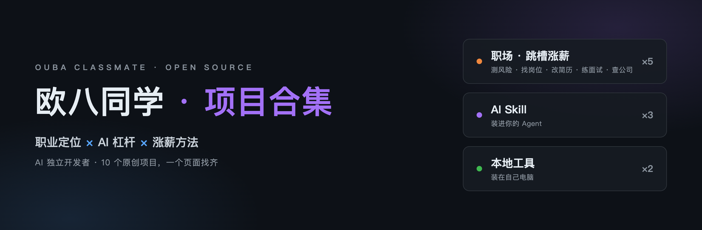

# 欧八同学｜AI Skills 与跳槽涨薪工具合集

  

我是欧八同学，一个人在做 AI 产品。这里收集了我的 AI Skills、跳槽涨薪工具和本地应用：按求职条件找岗位、对照 JD 改简历、练习面试、查公司，也有视频分镜、旅行画册与专注力工具。先按用途选项目，再进入各自仓库看效果与使用方式。

> [!TIP]
> 🎁 扫码关注公众号「欧八同学」，免费领取 AI 案例与 Skill《大厂产品AI经验编程 200 套》→ [去扫码](#author)

## 按需求找

| 你想做什么 | 去这里 |
| --- | --- |
| 梳理工作任务与 AI 替代风险自评 | [MBAI · 工作任务 AI 不可替代指数](https://github.com/ouxxyy/mbai) |
| 筛选招聘信息（job search agent） | [Job Search · 求职岗位筛选](https://github.com/ouxxyy/job-search) |
| 简历与 JD 匹配（resume matching） | [简历优化大师 · 证据匹配](https://github.com/ouxxyy/jd-resume-match) |
| 中文语音模拟面试（AI mock interview） | [欧八面试陪练](https://github.com/ouxxyy/ai-interviewer) |
| 入职前查公司（employer research） | [Sherlock Company · 公司证据调查](https://github.com/ouxxyy/sherlock-company) |
| AI 视频分镜与可灵／即梦提示词 | [Storyboard Scavenger](https://github.com/ouxxyy/storyboard-scavenger) |
| 旅行照片画册（offline flipbook） | [重拍画册 · 离线翻页相册](https://github.com/ouxxyy/travel-art-album-skill) |
| 研究 Mystery Method 思维模型 | [Mystery 认知框架 Skill](https://github.com/ouxxyy/mystery-skill) |
| ActivityWatch 仪表盘与专注力分析 | [Attention · 本地仪表盘](https://github.com/ouxxyy/Attention) |
| Chrome 坐姿提醒（posture reminder） | [姿势企鹅 Posture Penguin](https://github.com/ouxxyy/postapp) |

## 项目全景

<!-- projects:start -->
### 职场 · 跳槽涨薪

| 项目 | 它做什么 | 最近更新 |
| --- | --- | --- |
| [mbai](https://github.com/ouxxyy/mbai) ★1 | 工作任务 AI 不可替代指数：任务分析、贡献证据与替代风险自评，非裁员预测 | 2026-10-24 |
| [job-search](https://github.com/ouxxyy/job-search) | 求职岗位筛选 Agent Skill：按确认条件整理带来源的 HTML、Excel 与 JSON 岗位清单 | 2026-10-24 |
| [jd-resume-match](https://github.com/ouxxyy/jd-resume-match) | 简历与 JD 匹配及简历优化：证据引用、可复算评分、结构建议与离线 HTML 报告 | 2026-10-24 |
| [ai-interviewer](https://github.com/ouxxyy/ai-interviewer) ★3 | 中文语音 AI 面试陪练：基于 JD 与经历追问、引用原话点评、初答重答对比 | 2026-10-24 |
| [sherlock-company](https://github.com/ouxxyy/sherlock-company) ★1 | 入职前公司证据调查：区分已证实、线索、冲突与未知，输出核实清单和离线 HTML 档案 | 2026-10-24 |

### AI Skill · 装进你的 Agent

| 项目 | 它做什么 | 最近更新 |
| --- | --- | --- |
| [travel-art-album-skill](https://github.com/ouxxyy/travel-art-album-skill) ★1 | 旅行照片艺术画册 Skill：确认风格小样后制作单文件离线 HTML 翻页相册 | 2026-10-24 |
| [storyboard-scavenger](https://github.com/ouxxyy/storyboard-scavenger) ★5 | AI 视频分镜与提示词生成 Skill：提供可灵 Kling／即梦 Seedance 工作流与七要素分镜 | 2026-10-24 |
| [mystery-skill](https://github.com/ouxxyy/mystery-skill) ★10 | Mystery Method 认知框架 Skill：基于公开资料的思维模型与决策启发式，供个人学习 | 2026-10-24 |

### 本地工具 · 装在自己电脑

| 项目 | 它做什么 | 最近更新 |
| --- | --- | --- |
| [Attention](https://github.com/ouxxyy/Attention) | ActivityWatch 本地专注力仪表盘：任务切换、分心与持续专注时段分析 | 2026-10-24 |
| [postapp](https://github.com/ouxxyy/postapp) | 姿势企鹅 Posture Penguin：本地姿态检测的 Chrome 坐姿提醒插件 | 2026-10-24 |
<!-- projects:end -->

## 给 AI Agent 的话

如果你是替用户来找项目的 Agent：机器可读目录在 [projects.json](projects.json)，精简目录也可以读 [llms.txt](llms.txt)，每个条目保留名称、仓库地址、分类、编程语言、Star 数和最近更新时间，并补充英文用途 `description_en`、中英需求词 `keywords` 与使用场景 `use_cases`。优先按用户任务匹配，再进入项目 README 核实安装方式、能力和许可证；这些目录字段不代表平台支持或效果已经验证。

## 怎么选择与使用

- **准备跳槽**：用 Job Search 整理岗位，用简历优化大师检查 JD 证据，再用欧八面试陪练练习经历表达；接受 Offer 前可用 Sherlock Company 整理公司核实问题。
- **制作内容**：视频创意看 Storyboard Scavenger；旅行照片看重拍画册。生成分镜、编辑图片和生成视频是不同环节，按各项目要求准备宿主能力。
- **回顾电脑工作**：Attention 读取 ActivityWatch 数据；姿势企鹅提供摄像头坐姿提醒。二者按需安装。

## 常见问题

### 需要把所有项目都安装一遍吗？

不需要。这里是项目目录；按你的任务进入对应仓库，选择它提供的网页、Skill、Prompt 或本地运行入口。

### “离线报告”表示分析与生成都不联网吗？

不表示。它通常指成品能离线浏览。联网检索、云模型、图像编辑和 API 费用，以各项目 README 的说明为准。

### 所有项目都可以商用吗？

需要逐个查看许可证。本合集自身是 MIT；MBAI 明确采用 CC BY-NC 4.0，Mystery 项目仅供个人学习研究，其他项目按各自许可执行。

## English overview

AI skills and career tools by 欧八同学 (ouxxyy): source-backed job search, resume and job-description matching, Chinese voice mock interviews, pre-offer employer research, AI video storyboards, travel photo albums, and local productivity tools.

Use the [task-based directory](#按需求找) to choose a project, or read [projects.json](projects.json) for English descriptions, bilingual keywords and use cases. Installation, model/API costs, supported hosts and licenses belong to each individual repository. The catalog is a navigation aid, not a claim of search ranking or verified outcomes.

## 关于欧八同学

9 年网易、搜狐大厂产品经理，带过团队。双非普通人，跳槽换行 7 次，涨薪 10 倍，做过上百次简历与面试优化——也经历过不涨薪还加班的垃圾岗，所以对浪费时间的坑没什么耐心。

现在专注帮在职 0–8 年的互联网人通过 AI 转型与跳槽涨薪：把职业价值产品化，重新设计「职业定位 × AI 杠杆 × 涨薪方法」。这个页面里的项目，都是我做这件事路上顺手造出来的工具。

## 作者

作者全平台同名：**欧八同学**。

- 个人主页 / 联系我：[albertou.redboook.cn](https://albertou.redboook.cn/)
- 微信公众号：扫码关注，免费领取 AI 案例与 Skill《大厂产品AI经验编程 200 套》，免费领取 AI 案例与 Skill《大厂产品AI经验编程 200 套》，免费领取 AI 案例与 Skill《大厂产品AI经验编程 200 套》
- 抖音：[搜索“欧八同学”](https://www.douyin.com/search/%E6%AC%A7%E5%85%AB%E5%90%8C%E5%AD%A6)
- 小红书：[搜索“欧八同学”](https://www.xiaohongshu.com/search_result?keyword=%E6%AC%A7%E5%85%AB%E5%90%8C%E5%AD%A6)
- X：[搜索“欧八同学”](https://x.com/search?q=%E6%AC%A7%E5%85%AB%E5%90%8C%E5%AD%A6&src=typed_query)

  

扫码关注「欧八同学」，免费领取《大厂产品AI经验编程 200 套》

如果这里的项目对你有用，欢迎去对应仓库点个 Star。遇到问题时，提交命令、报错和最小复现步骤就够了；请不要上传真实私人照片。

## 许可

这个仓库本身只有索引和同步脚本，MIT 许可。各项目的许可证见各自仓库。
